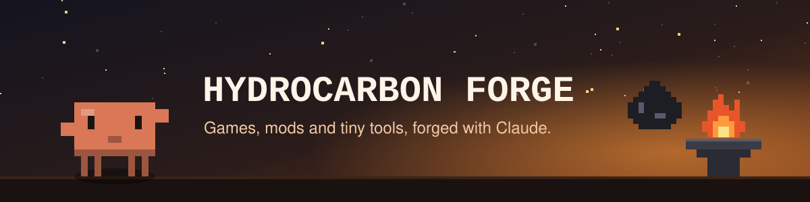

<b>Games, mods and tiny tools, forged with Claude.</b> 
Everything here is open source, free, and built hands-on with Claude Code.

## 🔥 Projects

<table>
<tr>
<td width="50%" valign="top">

### 🧡 [Claude Buddy](https://github.com/Hydrocarbon-Forge/claude-buddy)

A tiny pixel-art Claude who lives on your screen. He wanders, follows your cursor, naps, makes little noises, and answers anything you type into his speech bubble through Claude Code. Dress him up with hats, colors and accessories.

**[⬇ Download](https://github.com/Hydrocarbon-Forge/claude-buddy/releases/latest)**

</td>
<td width="50%" valign="top">

### 🖥️ [Serverworks](https://github.com/Hydrocarbon-Forge/serverworks)

A Fabric mod for Minecraft 26.3. Build a server rack, load it with mods and plugins straight from Modrinth, switch it on, and walk into the real server it runs.

**[⬇ Download](https://github.com/Hydrocarbon-Forge/serverworks/releases/latest)**

</td>
</tr>
</table>

## 🛠️ Forged with

Hydrocarbon Forge is an independent hobby workshop. Claude Buddy is fan-made and not affiliated with or endorsed by Anthropic.
